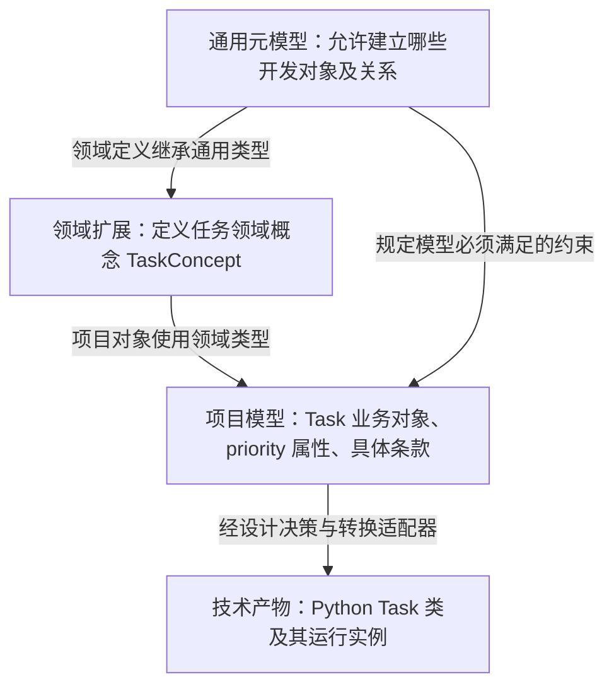
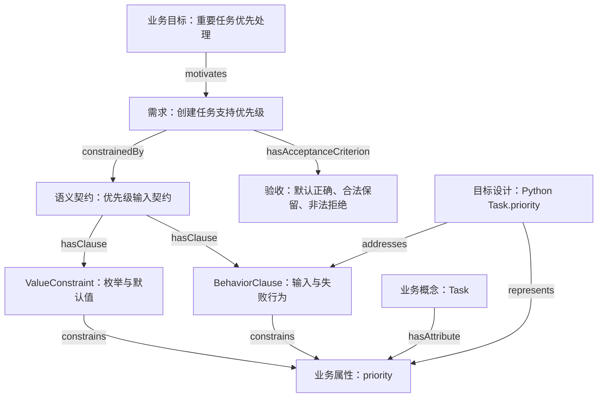
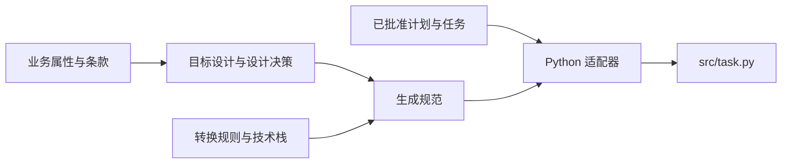
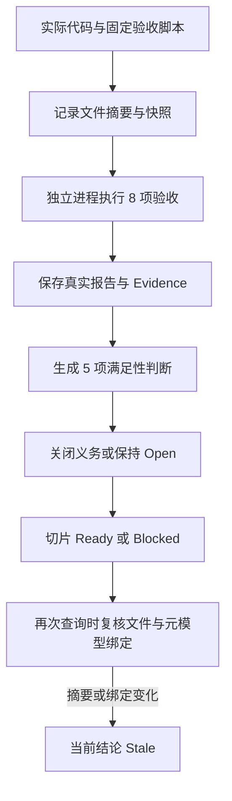
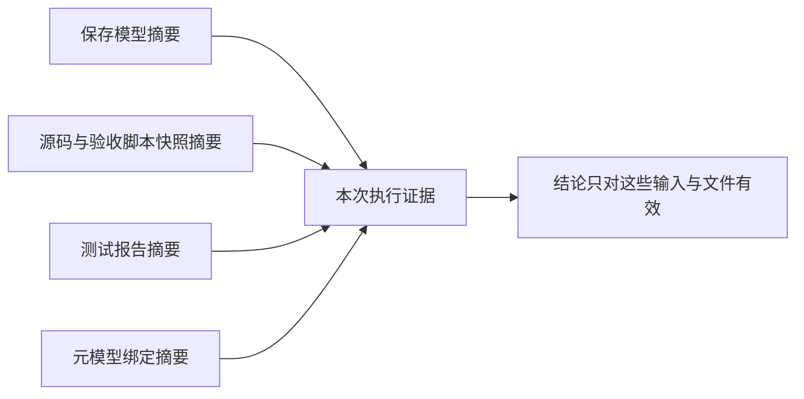
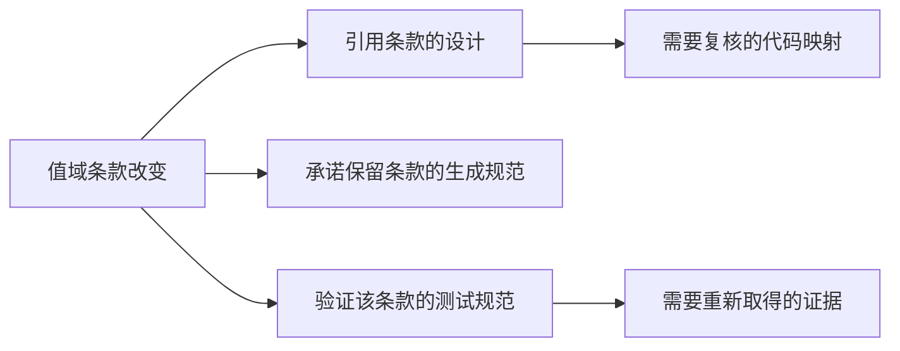

# 从业务语义到可验证代码：基于本体的代码生成讲解报告

日期：2026-09-08 · 对象：业务分析、架构设计、开发与测试团队

本报告以 code-ontology 当前实现及一次真实的“任务优先级输入”执行为依据。图中凡注明“设计方向”的内容均未计入已实现能力。数据来自本地模型、源码和验收报告，不包含估算的生产效率或成本收益。

## 1. 这套方法解决什么问题

开发一项业务功能，团队需要持续回答四个问题：**要实现什么、为什么这样设计、哪些代码负责实现、凭什么判断完成。**

基于本体的代码生成，把这些答案保存为具有明确类型、关系、约束和版本的模型，再由具体执行器完成代码转换及验证。其核心价值是让需求、设计、实现和证据之间的关系可追溯，让开发过程中的检查可以自动执行。

在当前案例中，我们已能从保存的任务输入模型生成 Python 代码，执行真实验收，形成与模型、源码快照绑定的证据，并在文件变化后将旧结论标记为失效。

这不是对任意业务描述的自动编程承诺。目前能运行的是一个边界清楚的转换适配器：`python-enum-dataclass-v1`。模型还能够表达更多开发对象，但那些对象要参与执行，仍需对应的规则、算法或人工操作。

## 2. 四种对象，分别承担什么责任

### 2.1 元模型、领域定义、项目模型和运行对象



图 1：从通用语义定义到具体代码。四者有联系，但承担的职责不同。

| 层次 | 本例对象 | 回答的问题 |
| --- | --- | --- |
| 通用元模型 | `BusinessConcept`、`BehaviorClause`、`GenerationSpecification` | 我们怎样描述业务、行为和生成责任？ |
| 领域扩展 | `TaskConcept rdfs:subClassOf dev:BusinessConcept` | 任务领域采用什么概念类型？ |
| 项目模型 | `task rdf:type TaskConcept`，关联 `priority` | 本次项目里的任务属性、规则和目标是什么？ |
| 技术产物与运行对象 | Python `class Task`；运行时 `Task("high")` | 这些语义具体怎样实现、怎样执行？ |

这里有一个容易混淆的地方：项目 RDF 中的 `task` 表示“任务业务对象的模型节点”，不是某个用户今天创建的任务记录；生成出来的 Python `Task` 又是另一种技术表示。业务概念和技术类通过映射连接，不能直接当成同一个对象。

### 2.2 本体文件、约束和执行器怎样分工

| 组成部分 | 本项目中的作用 | 不负责的事情 |
| --- | --- | --- |
| OWL / RDFS 本体 | 定义类型、继承、关系以及领域词汇 | 不自行编写业务算法 |
| SHACL 约束 | 检查必填关联、基数、值域和模型/快照一致性 | 不证明测试命令真实执行过 |
| SPARQL 查询 | 沿关系查询需求、条款、设计和证据 | 图上可达不等于已实现或已受影响 |
| 转换适配器 | 读取支持的设计结构，生成具体语言代码 | 不解释任意自然语言行为 |
| 验证执行器 | 实际运行测试，记录结果与文件摘要 | 有限用例不构成对全部输入的形式化证明 |
| 工作台与存储 | 编辑、保存版本、触发执行、展示证据与失效状态 | 当前尚无完整的元模型发布迁移体系 |

因此，真正可执行的方式是：**模型提供明确输入和检查依据，适配器实现转换算法，真实测试提供验收证据。**

### 2.3 放到整个代码库的开发生命周期中

完整方法还需要处理已有代码，而不只是从零生成文件。总体架构中的主线是：业务目标与契约确定目标设计，当前代码事实与目标设计形成差异，差异形成实现和验证义务，批准计划指导执行，执行后的事实与证据支持验收。以下是生命周期职责，不表示本报告的小案例已验收全部阶段。

| 阶段 | 主要模型或产物 | 关键问题 |
| --- | --- | --- |
| 建立元模型与领域词汇 | 类型、关系、约束、版本绑定 | 团队是否使用同一套语义？ |
| 描述业务目标与要求 | 需求、条款、验收条件 | 业务要什么，哪些行为不可遗漏？ |
| 建模现有代码库 | Current：实际文件、类型、调用及契约事实 | 代码现在是什么样，采集范围是什么？ |
| 形成目标设计 | Desired：业务对象到技术表示的设计与理由 | 希望代码变成什么样？ |
| 规划差异与影响 | Proposed：候选变更、义务、影响评估 | 要改哪里，还需检查哪些消费者？ |
| 审查批准并执行 | Approved：批准计划；生成规范或实现任务 | 哪个版本、哪些操作获得了批准？ |
| 重新采集并验证 | Actual：实现后的事实；测试报告与证据 | 实际完成了什么，是否满足本次要求？ |
| 交付与后续变更 | 满足性判断、交付判断、证据失效检查 | 结论适用于哪个版本，下次变化后是否仍有效？ |

Current 是已采集事实，Desired 是目标，Approved 是获准执行的计划，Actual 是执行后的观测；不能把目标设计直接复制为“实际实现”。业务模型中的 Task 与代码模型中的 Python 类也应通过明确的表示或实现关联连接，不能简单合并为一个节点。

对于已有项目，生成范围应是批准变更涉及的实现切片，配合影响评审与重新验证，而不是默认重写整个代码库。本报告下面的真实案例仅演示新目录中的受控生成与文件级采集，未完成现有仓库的 AST 对账、跨组件改造或部署验收。完整主线参见[总体架构](00-overall-architecture.md)。

## 3. 案例：让创建的任务具有合法优先级

### 3.1 先限定业务范围

业务目标是“重要任务优先处理”。本次只实现它的一个前置能力：创建任务时能够表达合法优先级。

具体需求如下：

1. 优先级允许 `low`、`medium`、`high`。
2. 未传优先级时采用 `medium`。
3. 传入合法值时保留该值。
4. 非法输入抛出明确的校验错误。

任务调度顺序、数据库字段、API 返回码以及部署均不属于本次验收范围。即使这个切片 Ready，也不能据此宣布“重要任务已被优先调度”。

### 3.2 把文字变成可关联的模型



图 2：同一个 priority 属性同时受值域与行为条款约束；验收条件从需求侧明确提出。

下面是为了阅读而缩短标识后的模型摘录。完整模型还包含归属、版本、批准和验证关联；片段不能单独通过全部约束。

```turtle
p:task a p:TaskConcept ;
    dev:hasAttribute p:priority .

p:priority a dev:BusinessAttribute .

p:valueClause a dev:ValueConstraint ;
    dev:constrains p:priority ;
    dev:valueDatatype xsd:string ;
    dev:allowedValue "low", "medium", "high" ;
    dev:defaultValue "medium" .

p:behaviorClause a dev:BehaviorClause ;
    dev:constrains p:priority ;
    dev:precondition "创建任务输入" ;
    dev:postcondition "得到合法优先级的任务" ;
    dev:failureBehavior "未知优先级返回明确的校验错误" .
```

仅声明 `priority` 是字符串无法表达上述全部要求。值域条款说明允许哪些值，行为条款说明在操作中应发生什么，验收条件说明观察什么结果。

### 3.3 行为在这里怎样起作用

当前 `BehaviorClause` 已有前置条件、后置条件和失败行为，但主要通过文本表达。任务输入适配器实现了一组固定语义：在数据类构造时采用默认值、保留允许值、用 `ValueError` 拒绝其他值。

因此，“抛出异常”是适配器已经实现的行为。模型中的 `failureBehavior` 会进入生成源码的追溯信息，但不能随意改成“返回 HTTP 422”就自动得到 HTTP 接口实现。那需要新的技术设计、行为表达及执行适配器。

| 行为内容 | 模型如何表达 | 当前怎样执行 |
| --- | --- | --- |
| 允许的优先级 | `allowedValue` | 生成允许值集合与成员检查 |
| 未传字段的处理 | `defaultValue` 与行为说明 | 生成数据类字段默认值 |
| 创建后的合法性 | `postcondition` | 由构造时校验及测试检查 |
| 非法输入的处理 | `failureBehavior` | 当前适配器固定抛出 `ValueError` |
| 状态流转、重试、并发、补偿 | 尚缺统一可执行行为模型 | 尚未通用实现 |

## 4. 模型怎样一步步变成代码

### 4.1 先确定设计，再确定生成规范

设计决策说明：“优先级采用字符串枚举，在 Python 数据类构造边界执行校验”。目标表示通过 `represents` 指向业务属性，通过 `addresses` 指向应落实的条款。

生成规范再固定输入设计、转换规则、技术栈、输出路径，以及承诺保留的条款：



图 3：元模型规定这些输入必须怎样关联；适配器负责真正生成代码。

生成器不会只看一个类名就开始写文件。当前实现会检查生成规范是否唯一、是否属于批准计划中的 Template 任务，以及其设计、规则和保留条款是否符合支持范围。专用任务切片入口还会校验保存模型的元模型绑定，并限制默认优先级的可选值。

### 4.2 从输入到输出的对应关系

| 输入模型或执行约定 | 生成结果 | 解释 |
| --- | --- | --- |
| Task 领域概念及技术表示 | `class Task` | 生成具体语言类型 |
| `priority` 业务属性标识 | `priority` 字段 | 业务属性有明确技术落点 |
| 三个 `allowedValue` | `Literal[...]`、`ALLOWED_PRIORITY` | 静态类型提示和运行时值集合 |
| `defaultValue = medium` | 字段默认值 `'medium'` | 未传入时采用该值 |
| 当前适配器的输入校验语义 | `__post_init__`、`ValueError` | 运行时拒绝集合外的值 |
| 模型输入、规范、规则和条款标识 | 源码中的追溯常量 | 便于反查生成依据 |

本次实际生成的核心代码如下，省略了顶部追溯常量：

```python
ALLOWED_PRIORITY = ('high', 'low', 'medium')

@dataclass(frozen=True)
class Task:
    priority: Literal['high', 'low', 'medium'] = 'medium'

    def __post_init__(self) -> None:
        if self.priority not in ALLOWED_PRIORITY:
            raise ValueError('priority' + " must be one of " + repr(ALLOWED_PRIORITY))
```

枚举显示顺序不表示调度优先级顺序。`Literal` 提供类型提示，实际拒绝非法值的是 `__post_init__` 中的检查。

源码还记录 `GENERATION_ADAPTER`、`GENERATION_SPECIFICATION`、`TRANSFORMATION_RULE`、`PRESERVED_CLAUSES` 和 `MODEL_INPUT_HASH`。这些字段说明代码的生成来源；是否满足条款需要继续验证。

## 5. 怎样从“生成成功”走到“有依据的完成”



图 4：代码生成、验收判断和结论复核是不同阶段。

验收程序以独立 Python 进程执行，不导入生成器。它读取生成的 `Task` 类，检查输入和输出。允许值及非法输入测试由固定程序明确列出，默认值预期来自保存的项目配置。

这种组织方式有助于避免测试只检查“模板是否输出了某段文字”。但生成器和验收程序仍由同一平台维护，不能称为独立机构审计或形式化证明。

### 5.1 真实验收数据

以下为 2026-09-08 北京时间 11:45:41 左右完成的真实执行，不是 Illustrative 示例报告。

| 测试 | 输入 | 预期 | 实际验收结果 |
| --- | --- | --- | --- |
| default | 未传 priority | `medium` | 通过 |
| retain-low | `low` | 保留 `low` | 通过 |
| retain-medium | `medium` | 保留 `medium` | 通过 |
| retain-high | `high` | 保留 `high` | 通过 |
| reject-'urgent' | `urgent` | `ValueError` | 通过 |
| reject-'' | 空字符串 | `ValueError` | 通过 |
| reject-None | `None` | `ValueError` | 通过 |
| reject-3 | 数字 `3` | `ValueError` | 通过 |

报告给出八项通过结果、退出码 0、空 stderr，并确认验收前后被记录文件未变化。8/8 是这八项测试的通过率，不是全部业务行为覆盖率。

验证时间戳差为 **0.130083 秒**。该区间覆盖本次验证子进程调用及结果处理附近的计时，不包含完整建模、人工审查或整个开发流程；单次小样本不能作为平台性能基准。

### 5.2 一个小案例在图中留下了什么

| 指标 | 实测值 | 口径 |
| --- | --- | --- |
| 项目模型三元组 | 254 | `model.ttl`，显式 RDF 断言 |
| 执行后证据图三元组 | 399 | `evidence.ttl`，包含模型、执行与判断 |
| 开发需求 | 1 | 显式 `dev:Requirement` |
| 值域条款 / 行为条款 | 1 / 1 | 两类条款各一个 |
| 验收条件 | 3 | 默认正确、合法保留、非法拒绝 |
| 生成 / 采集 / 验证执行 | 1 / 1 / 1 | 三种不同职责的真实记录 |
| 测试用例 | 8 | 固定验收程序实际执行 |
| 证据对象 | 1 | 指向一份真实测试报告 |
| 满足性判断 | 5 | 三项验收条件及两项条款 |
| 已关闭义务 | 2 | 一项实现义务、一项验证义务 |
| 交付判断 | Ready | 仅针对本模型的任务输入范围 |

三项验收条件细化为八个测试用例；五项判断共享这一份验收报告，不是五次独立测试。当前适配器采用整体判定：测试集合及快照检查全部通过，才将五项判断标为 Satisfied。它尚未实现逐条款的细粒度部分满足推断。

### 5.3 版本摘要为什么重要



图 5：同一个“通过”，必须说明是哪个模型、哪份代码、哪次报告。

本例有两种名称相近、含义不同的模型摘要：保存模型 `modelHash` 标识原始保存的 Turtle；生成源码中的 `MODEL_INPUT_HASH` 标识生成器接收的图，其中加入了批准及执行目录上下文。两者不同是正常的，不能混作同一字段。

`snapshotHash` 是对“源码文件和验收脚本的路径—内容摘要映射”再计算的摘要。报告和证据 Turtle 分别保留自己的摘要，读取记录时另行复核。

本报告读取时，接口返回 `status=Ready`、`currentStatus=Ready`、`changedFiles=[]`、`bindingCurrent=true`。这是查询当时的结果，不表示之后不会变化，也不意味着持续监控已启用。

## 6. 用一次变化理解核心价值

### 6.1 把默认值从 medium 改为 high

这是当前前端已经支持的操作：修改默认值后，保存一个新模型版本，再执行该版本。

| 需要保持一致的对象 | 随新版本改变的内容 |
| --- | --- |
| 值域条款 | `defaultValue` 从 medium 变为 high |
| 业务规则及验收说明 | 采用新默认值 |
| 生成代码 | 字段默认值为 high |
| 验收预期 | 未传 priority 应得到 high |
| 运行记录 | 使用新的模型标识、摘要和执行记录 |

旧版本和旧报告保留。新的结果回答的是“新模型对应的新代码是否通过本切片验收”，不会直接覆盖原结论。当前保存功能创建独立版本记录，尚未提供自动版本合并或完整语义差异计算。

如果直接修改旧执行目录中的 `task.py`，摘要复核会使当前结论成为 Stale，促使团队重新验证。该失效逻辑已有回归测试覆盖；本报告没有修改展示中的真实产物。

### 6.2 增加 urgent 优先级：尚需扩展的例子

若业务要求增加 `urgent`，当前任务切片入口会拒绝，因为适配范围固定为三个值。要支持它，需要同步修改领域约束、转换适配范围和独立验收程序，并评估调度、接口或存储是否受影响。

完整模型中的关系可以为评审提供候选路径：



图 6：变化影响评审路径。此图解释设计方向；当前专用切片没有自动完成所有跨组件影响分析。

## 7. 核心价值与代价

| 价值 | 具体机制 | 在本例中的体现 |
| --- | --- | --- |
| 降低语义遗漏风险 | 需求拆成可引用的条款与验收条件 | 默认值、允许值、非法输入分别有依据 |
| 保留设计理由 | 设计决策关联目标表示与条款 | 能解释为何选择字符串枚举及构造时校验 |
| 让生成依据可追溯 | 代码记录规范、规则、条款及输入标识 | 可从 Task 源码追到生成规范 |
| 让完成条件可检查 | 验证执行、证据、判断与义务分开建模 | 失败报告保留，失败时义务不关闭 |
| 限定旧证据的适用范围 | 模型、代码、测试、报告和元模型绑定摘要 | 文件变化后当前状态变为 Stale |
| 为后续复用与影响分析提供基础 | 采用共享类型和显式关系 | 可查询一个条款的设计、生成及验证引用 |

从投入看，仅为一个小数据类建立元模型、版本存储和证据服务，成本明显高于直接手写这个类。它的收益需要在重复开发、长期维护、多团队协作或有追溯要求的场景中累积。

当前可证明的是“上述机制已在一个限定切片中运行”。尚无对照实验能够支持“效率提高多少”“成本下降多少”或“缺陷减少多少”的量化结论。后续可统计条款遗漏数、变更后需人工复核的对象数、证据过期发现率、适配器复用次数和每次变更的审查时间，评估真实收益。

生成模板与本体承担不同责任：模板仍负责代码展开，本体补充业务意义、适用前提、输入关联和验收依据。AI 可以辅助提出业务模型、设计候选或实现补丁，但本次任务切片的代码生成与测试执行由固定程序完成，未调用大模型。

## 8. 当前规模与能力边界

本报告按当前本地安装清单统计：

| 范围 | 类 | 对象属性 | 数据属性 | 说明 |
| --- | --- | --- | --- | --- |
| 新增 dev 开发元模型 | 49 | 57 | 39 | 另有 1 个展示归类注解属性，不计入数据属性 |
| 当前目录合并的全部定义 | 240 | 296 | 75 | 包含 code、biz、eng、plan、dev |

清单包含 5 个本体文件、4 个 SHACL 文件，共 9 个定义与约束文件；dev 本体为 618 条三元组，对应 dev shapes 为 933 条三元组。类和关系数量反映表达范围，不能据此推算已实现功能数量。

| 能力 | 状态 |
| --- | --- |
| 定义查询、继承约束显示、元模型草稿与历史 | 已实现基础功能 |
| 任务输入项目模型保存、生成、验收和证据回写 | 本报告已有真实运行数据 |
| 元模型绑定失效、产物摘要失效检查 | 已实现查询时检查 |
| 前置、后置及失败行为的契约表达 | 已建模；一般行为仍是文本 |
| 状态机、分支、并发、重试与补偿的统一生成 | 尚未实现 |
| 多语言、多技术栈和任意领域的通用生成 | 尚未实现；现有单一 dev 适配器 |
| 业务 API、数据库、调度算法和生产部署 | 不在本次切片范围 |
| 元模型发布、兼容迁移及带身份签名的多人批准 | 尚未形成完整实现 |

进一步深化行为建模时，可以引入事件、状态、转换、守卫条件、动作、输入输出和异常策略，再分别实现可执行语义、转换器和独立验证器。只有模型节点、没有这些执行环节，仍无法自动产生完整业务逻辑。

## 9. 演示讲解顺序

建议沿着一个具体问题串讲：“为什么 `Task("urgent")` 应当失败，我们怎样确认它确实失败？”

1. 用图 1 区分元模型、领域概念、项目模型和 Python 类。
2. 用图 2 展开 priority 的值域条款、行为条款及验收条件。
3. 用图 3 和代码对应表展示输入如何变成默认值与运行时检查。
4. 打开实际源码，找到 `__post_init__` 和追溯常量。
5. 打开验收报告，对照八项输入与结果，解释为何需要真实运行。
6. 用图 4、图 5 说明“代码已生成”“验收通过”“当前证据仍有效”的区别。
7. 在工作台查看保存模型、执行历史和摘要复核；最后说明当前仅完成任务输入能力。

工作台入口：`http://127.0.0.1:8080/` →「00 元模型中心」→「项目实战：任务优先级开发闭环」。

## 附录：数据与实现依据

本报告的数值在 2026-09-08 从本地文件重新读取、计数及重算摘要。图表是基于该模型的讲解示意，不是 UI 截图。

- 模型 ID：`e74cc45a-e76e-43e2-8dc5-553208c5d9ef`
- 执行 ID：`bd68749b-3ea9-441f-96d3-b6c5635c3e67`
- 保存模型摘要：`73f86f44ead373a5c1870c21bf5a2ad534fc3fdc965cde2d7f13f35a588a0cf9`
- 源码摘要：`6098c76a00ba9b56d4aca37f7fb1dd1501840101e79ae72769e963d7dac5ad01`
- 快照摘要：`ce796ae82255e776e6acf67f0428535b00076809f7574796619f08825941afaf`
- 报告摘要：`feac3a71884be66af93e202fcd4d772abc088b1c9f74a76e25d67d7978b8b2df`
- 元模型绑定摘要：`da239c22fe1e7a661488ea9beb452dfcc4b38646419a199ef8dc0cfc9ea4629d`

| 依据 | 文件 |
| --- | --- |
| 元模型定义与约束 | [开发本体](../ontology/ontology-driven-development.ttl)、[SHACL](../shapes/ontology-driven-development-shapes.ttl) |
| 文件范围与绑定 | [元模型包清单](../models/development-metamodel.package.json) |
| 真实项目模型 | [model.ttl](../data/development-runs/bd68749b-3ea9-441f-96d3-b6c5635c3e67/model.ttl) |
| 真实生成源码 | [task.py](../data/development-runs/bd68749b-3ea9-441f-96d3-b6c5635c3e67/src/task.py) |
| 真实验收报告 | [report.json](../data/development-runs/bd68749b-3ea9-441f-96d3-b6c5635c3e67/report.json) |
| 真实执行及判断图 | [evidence.ttl](../data/development-runs/bd68749b-3ea9-441f-96d3-b6c5635c3e67/evidence.ttl) |
| 生成实现 | [development_codegen.py](../src/code_ontology_platform/development_codegen.py) |
| 执行与失效检查 | [development_slice.py](../src/code_ontology_platform/development_slice.py) |
| 独立验收程序 | [task_acceptance.py](../src/code_ontology_platform/task_acceptance.py) |
| 失败、旧绑定与快照变化测试 | [test_development_slice.py](../tests/test_development_slice.py) |
| 前端操作说明 | [实际业务切片指南](38-task-priority-operational-slice.md) |

运行目录属于本地数据，未随 Git 提交。跨机器分享报告时，图表与摘录仍可阅读；若需要独立复核，应同时提供上述产物和记录，或按操作指南重新执行。
